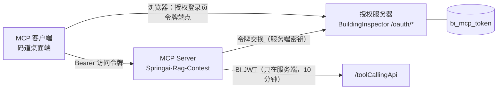

# MCP OAuth 登录设计

> Status: Approved（2026-10-19 用户确认：账号密码登录、令牌 7 天有效且到期重新登录、支持切换账号、首个目标客户端为码道桌面端）
>
> 验收记录见文末。WorkBuddy 已按本设计走通安装时登录。码道桌面端 0.2.3 做不到“只填地址就弹出授权页”，已增加手动令牌页 `/oauth/connect` 作为该客户端的接入方式。

涉及仓库：

- `Springai-Rag-Contest`：MCP Server，作为资源服务器。
- `BuildingInspector-Contest`：授权服务器，同时是业务数据所在系统。

## Background

MCP Server 骨架已经跑通，代码在 `src/main/java/edu/whut/cs/bi/rag/mcp/`，提供 7 个只读工具。目前用的是开发期临时方案：用户用 curl 调 `/jwt/login` 拿 BI JWT，写进客户端的 `Authorization` 请求头，MCP Server 再把它原样转给 `/toolCallingApi`。这个方案有四个问题：

- **用户体验差**：要手动 curl，令牌一小时就过期，过期后要手动替换。
- **违反 MCP 授权规范（2025-06-18）**：规范禁止 MCP Server 把客户端的令牌原样转发给下游（token passthrough），并要求令牌绑定到 MCP Server（audience）。
- **权限过大**：BI JWT 能访问整个 `/api/**`，包括写接口。
- **无法撤销**，也无法切换账号。

## Goals

- **登录**：客户端配置里只填服务地址。第一次连接时客户端自动打开浏览器，进入 BuildingInspector 的授权登录页。用户输入账号、密码、验证码，点“登录并授权”，浏览器自动回到客户端，工具即可使用。
- **有效期**：访问令牌 7 天有效，期间不需要再登录。到期后客户端收到 401，重新弹出登录页。不签发刷新令牌。
- **切换账号**：每次授权都必须输入账号密码，不复用浏览器里已有的网页登录状态。切换账号就是撤销当前令牌后重新授权，换另一个账号登录。提供三种触发方式：
  - 在对话里让 Agent 调用 `switch_account` 工具。
  - 在客户端里重新执行授权。
  - 在 BuildingInspector 网页端撤销授权。
- **规范**：遵循 MCP 授权规范（2025-06-18）。包括：
  - Protected Resource Metadata（RFC 9728）。
  - Authorization Server Metadata（RFC 8414）。
  - 动态客户端注册（RFC 7591）。
  - 授权码 + PKCE S256。
  - `resource` 参数（RFC 8707）。
- **令牌隔离**：访问令牌只对 MCP Server 有效。MCP Server 调 BuildingInspector 时，使用另外换来的、只在服务端内部使用的 BI JWT。
- **权限**：仍以若依为准，MCP 用户能看到的数据不超过他在网页端能看到的数据。
- **文档**：使用文档补上码道桌面端的接入步骤。

## Non-goals

- 不签发刷新令牌，不做自动续期。
- 不做写入类工具，scope 只有 `bridge:read`。
- 不接第三方身份源。
- 不做多实例部署。授权码只放在进程内存里，服务重启后，正在进行的授权需要重新走一遍。
- 不修复 `/toolCallingApi/project/{id}` 等老接口的越权问题，另行处理。

## Current Constraints

- **BuildingInspector**：Spring Boot 2.5 + Shiro + Thymeleaf（若依），JDK 17。
  - `SysLoginService.login(username, password)` 已经包含：验证码结果检查、账号状态检查、密码错误次数锁定（`SysPasswordService`）、登录日志。它只校验账号，不建立网页会话。
  - 验证码由 Shiro 的 `captchaValidate` 过滤器校验。配置是 `shiro.user.captchaEnabled: true`，类型为 `math`。验证码图片地址是 `/captcha/captchaImage`，匿名可访问。
  - MyBatis 会扫描 `edu.whut.cs.bi.*.mapper` 包和 `classpath*:mapper/**/*Mapper.xml` 文件。OAuth 代码放在 `bi-api` 模块，按现有的 controller / service / mapper / domain 分层。
  - BI JWT 由 `JwtUtils.createToken(loginName, 用户密码哈希, ttl)` 签发，用户改密码后旧的会自动失效。
- **Springai-Rag-Contest**：Spring Boot 3.5 + Spring AI 1.1.8，MCP SDK 0.18.3，使用 Streamable HTTP 传输（端点 `/mcp`，协议版本 `2025-06-18`）。2026-10-19 由 Spring Boot 3.3 + Spring AI 1.0.0（只支持 SSE）升级而来，原有聊天接口回归正常。
  - 认证入口是 `McpAuthFilter`。
  - 凭证经由 `McpTokenContext` 带到工具线程。
- **码道桌面端**：远程 MCP 配置为 `{"<名称>": {"type": "remote", "url": "...", "oauth": {}}}`，入口在“扩展 → 连接器 → 自定义配置”。它从本机发起连接，所以本地开发用 `127.0.0.1` 即可；正式部署需要 HTTPS。

## User-visible Behavior

### 首次登录（码道桌面端）

1. 在“自定义配置”里添加服务，保存后启用连接器：

   ```json
   {
     "bridge-inspector": {
       "type": "remote",
       "url": "http://127.0.0.1:8081/mcp",
       "oauth": {}
     }
   }
   ```

2. 客户端连接时收到 401，自动发现授权服务器，并完成动态客户端注册，这一步用户无感知。
3. 浏览器打开 BuildingInspector 的授权登录页。页面显示：
   - 申请授权的客户端名称，以及它的回调地址 host。
   - 申请的权限：“以你的身份只读查询你有权限的桥梁、项目、任务和病害数据”。
   - 有效期：7 天。
   - 账号、密码、验证码输入框，以及“登录并授权”和“拒绝”两个按钮。
4. 登录成功后，浏览器跳回客户端，客户端里显示工具可用。

### 日常使用

7 天内正常提问，不需要再登录。

### 到期、撤销和切换账号

- **令牌到期或被撤销**：下一次请求返回 401，客户端重新打开登录页。
- **在对话里说“切换账号”**：Agent 调用 `switch_account`，当前令牌立即作废，工具返回提示“请在客户端重新连接或授权此服务，并用新账号登录”。之后的请求返回 401，客户端重新打开登录页。
- **在 BuildingInspector 网页端“个人中心 → AI 授权管理”撤销**：撤销后最迟 60 秒生效。

### 错误路径

- **账号密码错误、验证码错误、账号被锁定或停用**：在授权页上显示具体原因，不会跳回客户端。
- **用户点“拒绝”**：带 `error=access_denied` 跳回客户端。
- **`client_id` 无效，或 `redirect_uri` 与注册值不一致**：只在授权页显示错误，不跳转，防止开放重定向。
- **BuildingInspector 不可用**：工具调用返回“后台暂不可用”。

## Design

### 组件



### 状态存储

| 数据 | 存在哪里 | 说明 |
|---|---|---|
| 动态注册的客户端 | 不存储 | `client_id` 由注册信息编码而成：`base64url(JSON{客户端名称, 回调地址列表, 签发时间}) + "." + HMAC-SHA256`。校验时验签，解出回调地址后严格比对 |
| 授权码 | 进程内存 | 5 分钟有效，只能使用一次，内存里只保存哈希 |
| 访问令牌 | 表 `bi_mcp_token` | 不透明的随机串，前缀 `bimcp_`，表里只存 SHA-256 哈希 |
| MCP Server 的令牌交换缓存 | MCP Server 进程内存 | 有效期取以下三者中最早的：BI JWT 过期时间、访问令牌过期时间、60 秒 |

`bi_mcp_token` 表的字段：

| 字段 | 说明 |
|---|---|
| `id` | 主键 |
| `token_hash` | 令牌的 SHA-256 哈希，唯一 |
| `user_id` | 授权的用户 |
| `client_id` | 签名编码后的客户端 id |
| `client_name` | 客户端名称 |
| `scope` | 授权范围 |
| `resource` | 令牌绑定的 MCP 地址 |
| `expires_at` | 过期时间 |
| `revoked_at` | 撤销时间，未撤销为空 |
| `create_time` | 签发时间 |
| `create_ip` | 授权时的 IP |
| `last_used_at` | 最近使用时间 |

### BuildingInspector 端点（授权服务器，都在 `bi-api` 模块）

| 端点 | 行为 | Shiro |
|---|---|---|
| `GET /.well-known/oauth-authorization-server` | 返回 RFC 8414 元数据：`issuer`、各端点地址、`response_types=[code]`、`grant_types=[authorization_code]`、`code_challenge_methods=[S256]`、`token_endpoint_auth_methods=[none]`、`scopes=[bridge:read]` | anon |
| `POST /oauth/register` | 动态注册，按 JSON 校验回调地址后返回签名编码的 `client_id`，一律注册为公开客户端 | anon |
| `GET /oauth/authorize` | 校验参数，渲染授权登录页。授权请求参数做 HMAC 签名后放在表单的隐藏字段里 | anon |
| `POST /oauth/authorize` | 验证隐藏字段的签名，并检查签发时间不超过 10 分钟。选择拒绝时，带 `access_denied` 跳回；选择授权时，调用 `SysLoginService.login` 校验账号，通过后签发授权码并 302 跳回 `redirect_uri` | anon + `captchaValidate` |
| `POST /oauth/token` | `authorization_code`：校验授权码、PKCE、`redirect_uri`、`client_id` 和 `resource`，在表里写一行，返回 `access_token`、`token_type=Bearer`、`expires_in=604800`、`scope`。令牌交换：只允许 MCP Server 使用，见下文 | anon |
| `POST /oauth/revoke` | RFC 7009：持有令牌即可撤销它，响应始终返回 200 | anon |
| `/system/mcpToken` 页面 | 个人中心里的 AI 授权管理：列出本人有效的授权，可以撤销 | user |

元数据、注册、令牌、撤销四个端点允许跨域（CORS），因为 MCP Inspector 这类在浏览器里运行的客户端需要。

### 令牌交换（MCP Server → BuildingInspector）

请求是 `POST /oauth/token`，参数如下：

- `grant_type=urn:ietf:params:oauth:grant-type:token-exchange`
- `subject_token=<访问令牌>`，`subject_token_type=urn:ietf:params:oauth:token-type:access_token`
- `resource=<MCP 规范地址>`
- 客户端认证用 HTTP Basic：`bi-mcp-server:<密钥>`，密钥从环境变量读取

BuildingInspector 依次校验：

1. MCP Server 的客户端密钥正确。
2. 令牌存在、未撤销、未过期。
3. `resource` 和令牌绑定的地址一致。
4. 用户未删除、未停用。

校验通过后，更新 `last_used_at`（同一令牌一分钟内最多更新一次），返回：

```json
{
  "access_token": "<BI JWT，10 分钟有效>",
  "issued_token_type": "urn:ietf:params:oauth:token-type:jwt",
  "token_type": "Bearer",
  "expires_in": 600,
  "user_id": 25,
  "login_name": "admin_ai",
  "scope": "bridge:read",
  "client_name": "码道",
  "subject_expires_at": 1761500000
}
```

任何一项校验失败都返回 `invalid_grant`。

### MCP Server 改动（资源服务器）

- **`McpAuthFilter`**：
  - 带 `bimcp_` 前缀的 Bearer 令牌走令牌交换。
  - 缺少令牌或令牌无效时返回 401，并带上 `WWW-Authenticate: Bearer resource_metadata="<public-base-url>/.well-known/oauth-protected-resource"`。
  - 后台不可用时返回 503。
  - 开关 `bi-mcp.auth.allow-legacy-jwt` 默认 false。打开后才接受直接传入的 BI JWT，只用于本地调试脚本。
- **元数据端点**：
  - `GET /.well-known/oauth-protected-resource` 和 `/.well-known/oauth-protected-resource/mcp`：`resource` 为 `public-base-url`，`authorization_servers` 为 BuildingInspector 的 issuer，`scopes_supported=[bridge:read]`。
  - `GET /.well-known/oauth-authorization-server`：从 BuildingInspector 取回元数据并缓存 5 分钟，用来兼容只在 MCP 地址上找授权服务器元数据的旧版客户端。
- **`McpTokenContext`**：保存交换得到的 BI JWT，以及用户信息和原始访问令牌。`switch_account` 需要原始访问令牌来调用撤销接口。
- **新工具 `switch_account`**：调用 `/oauth/revoke` 作废当前令牌，清掉对应的缓存，返回重新授权的提示。
- **审计日志**：记录 `userId`、`client_name`、工具名、耗时、是否成功，不记录令牌。

### 配置

| 项目 | 配置项 | 本地默认值 |
|---|---|---|
| MCP Server | `bi-mcp.public-base-url` | `http://127.0.0.1:8081` |
| MCP Server | `bi-mcp.resource-uris` | `http://127.0.0.1:8081`（客户端传 `.../mcp` 时由授权服务器归一为该地址） |
| MCP Server | `bi-mcp.oauth.issuer` | `http://127.0.0.1` |
| MCP Server | `bi-mcp.oauth.client-id` / `client-secret` | `bi-mcp-server` / `${BI_MCP_CLIENT_SECRET}`，本地有开发默认值 |
| BuildingInspector | `oauth.issuer` | `http://127.0.0.1` |
| BuildingInspector | `oauth.mcp-resource-uris` | 与 MCP Server 一致 |
| BuildingInspector | `oauth.mcp-server-client-secret` | `${BI_MCP_CLIENT_SECRET}` |
| BuildingInspector | `oauth.signing-secret` | `${BI_OAUTH_SIGNING_SECRET}` |
| BuildingInspector | `oauth.access-token-ttl` | 7 天 |
| BuildingInspector | `oauth.code-ttl` | 5 分钟 |

## Security and Reliability

- **令牌隔离**：
  - 访问令牌绑定 `resource`，只在 MCP Server 上有效。
  - BI JWT 只存在于 MCP Server 进程内，不返回给客户端，也不写进日志。
  - 数据库里只存令牌哈希。
- **令牌有效期 7 天的风险**：令牌泄露后，在过期前都可以使用。缓解措施有三点：一是绑定 audience，令牌只在我们的 MCP Server 上有效；二是只读权限；三是可以随时撤销，最迟 60 秒生效。另外，用户改密码后，新签发的 BI JWT 会换成新签名，但这不会让访问令牌失效，所以撤销功能是必须的。
- **回调地址白名单**：注册时只接受三类地址：
  - `http://localhost` 和 `http://127.0.0.1`，端口不限。
  - `https` 地址。
  - 自定义 scheme，但排除 `javascript:`、`data:`、`file:`、`vbscript:`。

  授权时严格比对注册时登记的地址。
- **授权页防伪造**：授权请求参数由服务端签名后放在隐藏字段里，提交时验签，因此请求内容无法被篡改。登录本身需要账号、密码和验证码；即使有人伪造提交，PKCE 也能保证授权码只能被发起授权的那个客户端兑换。
- **防暴力破解**：复用若依的密码错误次数锁定和图形验证码。
- **签名密钥**：
  - `oauth.signing-secret` 泄露后，可以伪造 `client_id` 和授权页的隐藏字段，但仍然拿不到令牌，因为还需要用户的账号密码。
  - 轮换这个密钥后，已注册的客户端会失效，需要重新注册，用户再登录一次即可。
- **失败状态**：写令牌表是单条插入，授权码在被兑换后才删除。令牌交换失败不会改变任何状态，客户端可以直接重试。
- **HTTPS**：本地用 http，正式部署时两个服务都要放在 HTTPS 反向代理之后，并配置好 `public-base-url` 和 `issuer`。

## Compatibility and Migration

### 不同 Agent 平台的差异

服务端只实现一套标准 OAuth。各平台的差异都在客户端一侧（2026-10-19 按各平台官方文档核对）：

| 差异 | 码道（桌面端/CLI） | Cursor | WorkBuddy | 对服务端的要求 |
|---|---|---|---|---|
| 配置方式 | 0.2.3 桌面端写 `oauth: {}` 不会打开授权页。可用配置是 `type: remote`、`headers.Authorization`、`oauth: false`，令牌从 `/oauth/connect` 获取 | `mcp.json` 的 `mcpServers` 加 `url`；本轮未实测自动登录 | `~/.workbuddy/mcp.json` 的 `mcpServers`，`type: streamable-http`，只写 `url`。不要预写 `Authorization` | 无。使用文档按客户端分开写 |
| 回调地址 | 客户端注册时提供 | 桌面版 `http://localhost:8787/callback` | 客户端注册时提供 | 动态注册时严格比对 |
| 连接从哪里发起 | 桌面端和 CLI 在本机；网页端在云端 | 桌面版在本机；网页版和云端 Agent 在 Cursor 服务器 | 桌面版在本机；企业版连接器经腾讯网关 | 云端发起时需要公网 HTTPS |
| 传输协议 | SSE、Streamable HTTP | SSE、Streamable HTTP | SSE、HTTP | 只提供 Streamable HTTP（`/mcp`） |
| 风险 | 0.2.3 已实测：识别 401 后停止，不打开浏览器 | 本轮未实测 | 5.8.3 已实测：不带令牌时会走标准 OAuth，并把令牌加密存在 `.credentials.v3.json` | 码道用 `/oauth/connect` 手动令牌 |

### 迁移

- 原聊天 Agent（`admin_ai` + `/jwt/login`）不受影响，`/toolCallingApi` 和 `jwt` 过滤器都不改。
- 开发期的令牌透传方案默认关闭。
- 数据库只新增一张表。回滚时删表、去掉 Shiro 规则即可。

## Alternatives

- **刷新令牌加自动续期**：用户体验更平滑，但要做令牌轮换和泄露检测。用户选择了“7 天到期后重新登录”，不采用。
- **完全不建表**：令牌做成签名 JWT，无法撤销，也就做不了切换账号和授权管理页，不采用。
- **三张表**（客户端、授权码、令牌）：在单实例部署下没有额外收益，不采用。
- **复用网页端的 Shiro 登录会话**：浏览器里已经登录过网页端时会自动沿用那个账号，切换账号很别扭；而且要改造登录页的跳转逻辑。改为在授权页单独输入账号密码，不采用。
- **把访问令牌直接转发给 `/toolCallingApi`，或直接把 BI JWT 当作访问令牌**：违反 MCP 规范（token passthrough、没有 audience 绑定），而且权限覆盖整个 `/api/**`，不采用。
- **个人访问密钥**：作为备用方案的候选，只有在目标客户端无法完成 OAuth 时才启用。

## Acceptance Criteria

- **码道桌面端**：配置里只写 `url` 和 `oauth: {}`，弹出授权页，登录后工具可用，`whoami` 返回登录的账号。
- **MCP Inspector**（`npx @modelcontextprotocol/inspector`）：完成发现、注册、登录、调用工具的全流程。
- **切换账号**：用账号 A 授权，调用 `switch_account`，再用账号 B 授权，`whoami` 返回 B。
- **网页端撤销**：在 BuildingInspector 网页端撤销后，60 秒内工具调用返回 401。
- **脚本化负向用例**（本地测试时关闭验证码）：

  | 用例 | 期望结果 |
  |---|---|
  | 无令牌或令牌无效 | 401，且带 `WWW-Authenticate` |
  | PKCE 校验失败 | `invalid_grant` |
  | 授权码重复使用 | `invalid_grant` |
  | 篡改过的 `client_id` | 授权页报错，不跳转 |
  | `redirect_uri` 与注册值不一致 | 授权页报错，不跳转 |
  | `resource` 不在白名单 | `invalid_target` |
  | 密码错误 | 授权页显示错误 |
  | 令牌过期（把 `access-token-ttl` 临时调短来测） | 401 |
  | 令牌交换时 MCP Server 密钥错误 | `invalid_client` |

- **兼容性**：原网页聊天框功能不变。
- **数据安全**：日志里没有明文令牌，数据库里只有令牌哈希。
- **文档**：使用文档中码道桌面端的步骤已按实际操作走通。

## Open Questions

- 正式部署的域名和 HTTPS 方案。本轮先在本地完成。
- 码道桌面端在令牌被撤销后不会自动打开授权页。更换令牌需要重新生成配置。

## 验收记录（2026-10-19）

原验收标准里“码道只填地址就弹出授权页”在桌面端 0.2.3 上没有达到。同一套 401 和 `WWW-Authenticate`，两个客户端的行为不同。

| 客户端 | 结果 |
|---|---|
| WorkBuddy 5.8.3 | 配置只写 `type: streamable-http` 和 `url`。收到 401 后完成资源发现、动态注册，打开 `/oauth/authorize`。登录后跳回 `workbuddy://workbuddy/mcp/custom-mcp%3A<名称>/oauth/callback`。8 个工具可用。令牌加密存在 `~/.workbuddy/connectors/<用户 id>/.credentials.v3.json`，不写入 `mcp.json`。 |
| 码道桌面端 0.2.3 | 内核日志出现 `AuthRequired` 和 `resource_metadata`，然后停在 “Authentication required”。没有请求 `/.well-known`、`/oauth/register` 或 `/oauth/authorize`。界面没有授权按钮。 |
| 码道 + 手动令牌 | `/oauth/connect` 登录后签发同一种 `bimcp_` 令牌。配置为 `type: remote`、`headers.Authorization`、`oauth: false`。连接成功，工具可用。 |

回调地址里的 `%3A` 不能再用 `UriComponentsBuilder.encode()` 编码，否则会变成 `%253A`，WorkBuddy 收不到授权码，界面停在「授权中」。跳转由 `OAuthRedirects` 在原地址后直接追加查询参数。

MCP Inspector 全流程、以及在码道对话里调用 `switch_account`，这次没有做。
